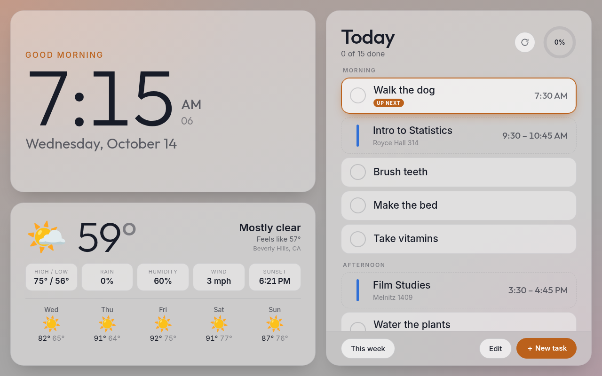
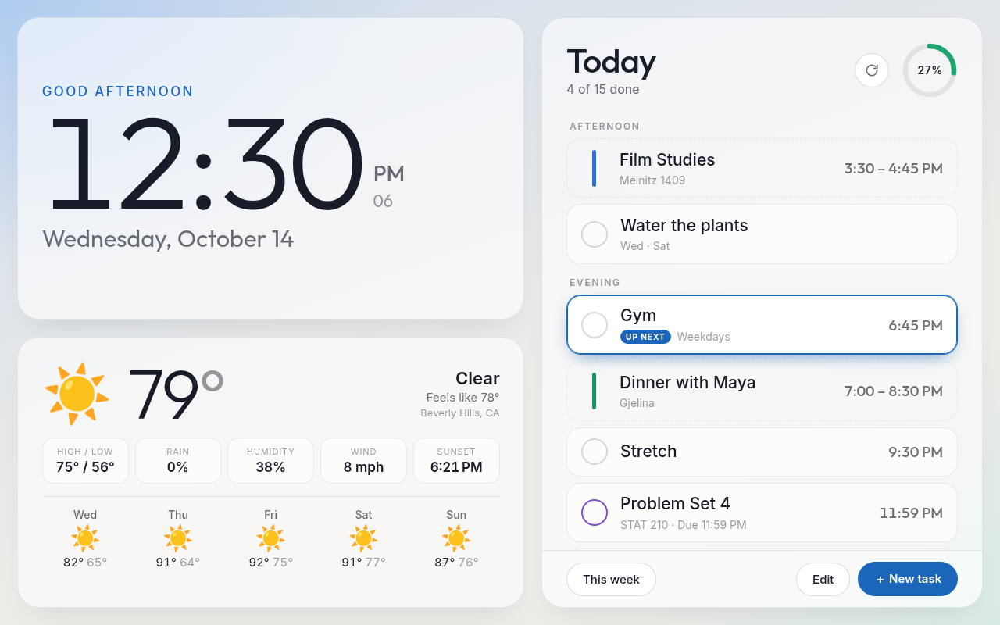
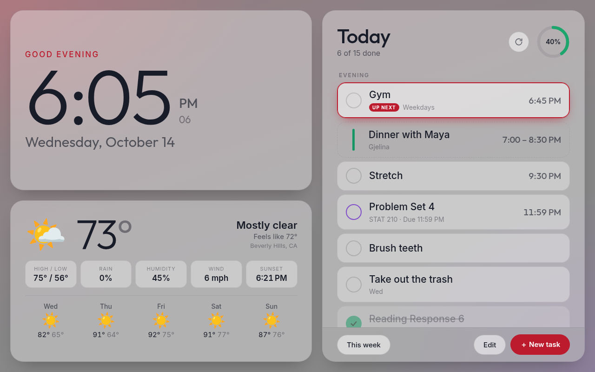
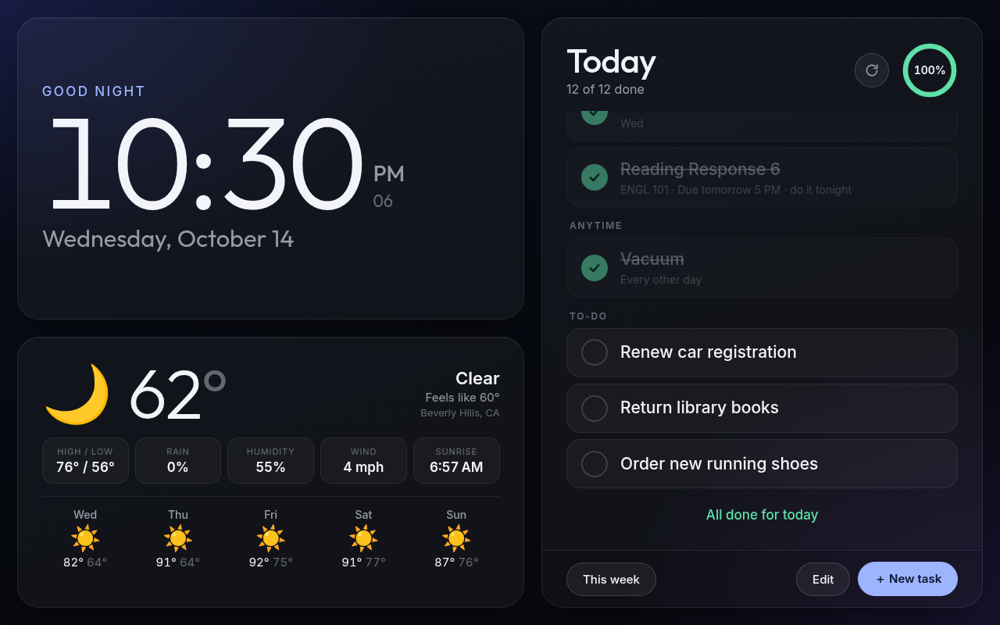
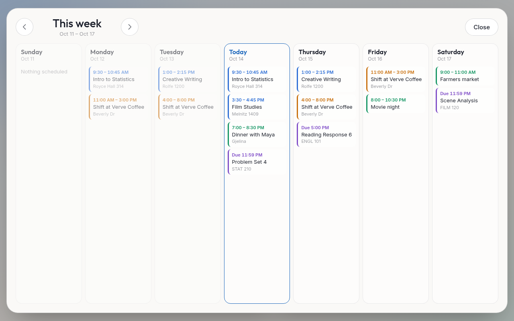

# WallTab

I wanted a daily to-do list to keep me accountable but this project eventually ended up evolving into a full dashboard for a wall-mounted tablet, hence the name. It runs on a Fire HD 8, so I intentionally avoided frameworks and fancy graphical effects. It does look beautiful, though.

## Features (not all of them)
- Dynamic color theme that adjusts to time of day with a smooth fade

     
- Progress wheel for tracking how much you've done today
  - Configurable to determine what actually counts as progress
- Rolling time animations to prevent a minute passing from catching your eye and distracting you
  - `CLOCK_FADE_SECONDS` needs to be a non-zero value
- Events synced from CalDAV server (and a refresh button)
  - Differentiates between calendars for classes, assignments, work, etc. for configuration purposes
  - 
- Recurring task items configured with markdown
  - Reminders for daily life things that don't belong on a calendar like shaving and showering
- Persistent to-do list that carries between days
  - I use this feature mostly as a shopping list
- Time and weather panels
  - Weather pulled from Open-Meteo; set location manually in `.env`, fallbacks use browser location request then IP geolocation
  - Time and date are based on the device's 

## Run it

### Compose
```bash
git clone https://github.com/swindlesmccoop/walltab
cd walltab
cp .env.example .env
docker compose up -d --build
```
The compose file expects an external Docker network named `proxynet` and publishes no host port, since it is meant to sit behind a reverse proxy such as Caddy (some functionality doesn't work without HTTPS).
- To reach it directly while testing, add a `ports` entry (for example `"4040:4040"`) to a local copy of `compose.yaml`, then open `http://<host>:4040` on the tablet.

### Deno
It can be run directly on your machine with a node runtime like deno but I haven't tested it enough to recommend, especially since Docker is just better for server software anyways
```bash
deno run -A --node-modules-dir=auto --env-file=.env server/index.js
```

## Configure

### Routines
A routine is a task that repeats. Each one is its own markdown file in `data/tasks/`, named after the task (for example `Brush teeth.md`). The server creates `_Template.md` there on first start, which explains the format; files starting with `_` are ignored.

```
When: morning
When: evening
Days: every day
```

- `When:` is `morning`, `afternoon`, `evening`, `anytime`, or a time such as `7:30am` or `noon`. Repeat the line for a task that happens more than once a day.
- `Days:` is `every day`, `weekdays`, `weekends`, or a list such as `Mon/Wed/Fri`, `MWF`, `Sundays`, or `Mon-Thu`.
- `Every:` is `other day` or `3 days`, and counts from the last check-off (or from when the file was added, if it was never checked).
- Every line is optional, and an empty file means every day, anytime.

### To-Do List
One-time items live in `data/todo.md` as a markdown checklist. Unchecked items show every day until they are done, and checked ones disappear the next day.
```
- [ ] Call the landlord
- [x] Mail the package
```
Tasks can also be added or removed from the dashboard itself, which creates or deletes the matching file or line. Check-offs are stored in `data/completions.json`, `data/todo-done.json`, and `data/assignments-done.json`, so the checklist resets on its own each day.

### Environment Variables
Everything on the technical side is set in `.env`. The full list with comments is in `.env.example`; the main options are below.
- `PORT` - port the app listens on inside the container (default `4040`).
- `DATA_DIR` - where tasks and check-offs are stored (default `./data`).
- `PUID` / `PGID` - the user and group the container runs as, so the data files stay editable without `sudo`.
- `TZ` - set your time zone so calendar events will show up correctly
- `COUNT_EVENTS` / `COUNT_TODOS` - what counts toward the daily completion ring.
- `CALDAV_URL` - self-explanatory
  - Make sure to set other CalDAV-related variables if needed
- `DAY_ROLLOVER_HOUR` - how late the day runs before the dashboard switches to "tomorrow" (0-23, blank for midnight).
  - This is useful for if you stay up past midnight often, as you can still complete tasks without it rolling over before you've gone to bed
